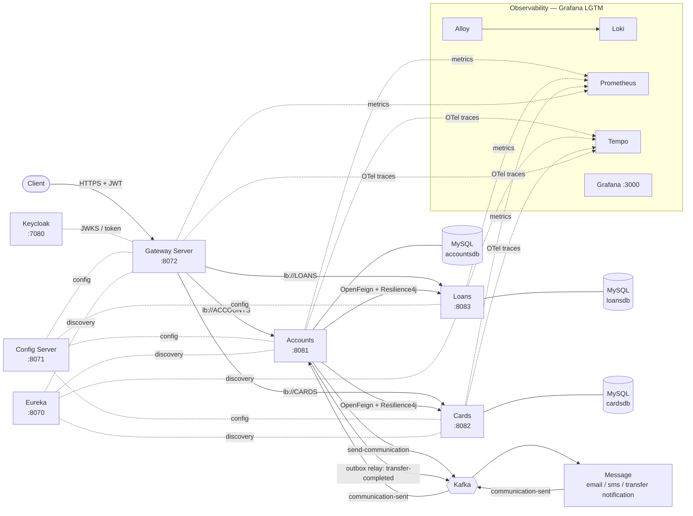

# 🏦 Banking Microservices

[](https://github.com/Gninho-silue/banking-microservices/actions/workflows/ci.yml)

A Spring Boot / Spring Cloud microservices banking system: customer accounts with idempotent transfers,
loans with an amortization schedule, cards, event-driven notifications, an API gateway secured by Keycloak,
and a Grafana LGTM observability stack.

## Based on

Built on the architecture of the EazyBytes *Master Microservices with Spring Boot, Docker & Kubernetes*
course. The service layout (accounts, loans, cards, message, config server, Eureka, gateway) and the shared
parent POM come from the course (originally `com.easybytes.*` packages and an `easy-bom` module, since renamed
to `dev.silue.banking.*` and `banking-bom`); the work listed below is my own addition on top of it.

## Beyond the course — what I added

| Area | What | Where |
|---|---|---|
| **Idempotent transfers** | `POST /api/transfers` with a mandatory `Idempotency-Key` header: a replay returns the stored transfer (same status and body, plus `Idempotent-Replayed: true`) and never debits twice; the same key with another payload → `409`. Insufficient funds → `422`. Deposits endpoint to fund accounts. | `accounts` |
| **Concurrency safety** | One transaction per transfer, both accounts locked with `PESSIMISTIC_WRITE` in **ascending account-number order** (no deadlock), key re-checked under lock, `UNIQUE` constraint as a last safety net. Deposits, `PUT /api/update` and the Kafka communication callback lock the row too — fixing a lost-update bug found by the manual docker-compose test. | `accounts` |
| **Transactional outbox → Kafka** | A `TransferCompleted` event is written to `outbox_events` in the transfer's transaction; a scheduled relay reads it with `FOR UPDATE SKIP LOCKED`, publishes it (synchronous producer) to `transfer-completed`, then sets `published_at`. At-least-once delivery, de-duplicable on `transferId`. | `accounts` |
| **Transfer notifications** | New `transferNotification` consumer on `transfer-completed`. | `message` |
| **Loan amortization schedule** | Pure-Java `AmortizationCalculator` (constant payments, `BigDecimal`, `DECIMAL64`, HALF_EVEN, last installment absorbs rounding so the capital ends at exactly `0.00`) and `GET /api/loans/schedule`. Loan amounts migrated from `Integer` to `BigDecimal`; loans now carry a rate, a term and a start date. | `loans` |
| **Test suite** | **205 tests**: JUnit 5 + Mockito unit tests, `@WebMvcTest` controller tests, `@DataJpaTest` and `@SpringBootTest` integration tests against **MySQL 8.4 and Kafka 4.1 (Testcontainers)**, incl. concurrency tests (20 parallel transfers on one account, 20 parallel replays of one key). Written test-first for the new features. | all |
| **Coverage** | JaCoCo with a **70 % line-coverage gate on `service/`** (`./mvnw verify` fails below it). Measured: **100 % on `service/`** in accounts, loans and cards; 97.6 % / 98.4 % / 97.4 % overall. | `banking-bom` |
| **CI** | GitHub Actions on every push / PR to `main`: one job per service (7), Temurin 21, Maven cache, `./mvnw -B verify`, JaCoCo reports as artifacts. Build and tests only — no deployment. | `.github/workflows/ci.yml` |
| **Bugs fixed** | Missing `-parameters` compiler flag (every `@RequestParam` endpoint returned 500 when built with Maven/Jib); springdoc BOM downgrading `spring-cloud-function` (stream binder crash); invalid request parameters returning 500 instead of 400; lost update on account balances. | `banking-bom`, services |
| **Repository hygiene** | Docker volume data (`.data/`) no longer tracked, tighter `.gitignore`, `mvnw` scripts executable. | root |

## Architecture



| Service | Port | Responsibility |
|---|---|---|
| `configserver` | 8071 | Centralized configuration (native profile, `classpath:/config`) |
| `eurekaserver` | 8070 | Service registry |
| `gatewayserver` | 8072 | Single entry point (`/easybank/{accounts,loans,cards}/**`), JWT resource server, correlation id; circuit breaker (accounts), retry (loans), Redis rate limiter (cards, 1 request/s) |
| `accounts` | 8081 | Customers, accounts, balances, deposits, transfers, outbox; aggregates loans and cards |
| `loans` | 8083 | Loans and amortization schedules |
| `cards` | 8082 | Cards |
| `message` | 8084 | Kafka consumers (email, sms, transfer notifications) |

## Tech stack

- **Java 21**, **Spring Boot 4.0.0**, **Spring Cloud 2025.1.0** (Config, Netflix Eureka, Gateway, OpenFeign, Stream with the Kafka binder, Circuit Breaker / Resilience4j)
- **MySQL 8** (one database per service, schema in each service's `src/main/resources/schema.sql`), Spring Data JPA / Hibernate
- **Apache Kafka 4.1**
- **Keycloak 26** (OAuth2 / OIDC, roles `ACCOUNTS`, `LOANS`, `CARDS` checked by the gateway)
- **springdoc-openapi 2.8** (Swagger UI)
- **Testcontainers 2.0**, JUnit 5, Mockito, AssertJ, Awaitility, **JaCoCo**
- **Jib** images, **Docker Compose** (`default`, `qa`, `prod`), **Helm** charts and **Kubernetes** manifests
- **OpenTelemetry** Java agent, **Grafana**, **Loki**, **Tempo**, **Prometheus**, **Alloy**

## Running it

### Prerequisites

- JDK 21 and Docker (Docker Desktop on Windows/macOS). Maven is not needed: every service has its own `./mvnw`.

### Build the images

Each service is an independent Maven project inheriting from `banking-bom` (through `relativePath`, no install needed).
`docker-compose/default/docker-compose.yml` references images tagged `3.2`:

```bash
for s in configserver eurekaserver accounts loans cards message gatewayserver; do
  (cd $s && ./mvnw -B compile jib:dockerBuild -Dimage.tag=3.2)
done
```

### Start the stack

```bash
cd docker-compose/default
docker compose up -d
```

This starts Kafka, Keycloak, Redis (gateway rate limiter), the three MySQL databases, the observability stack (Loki, Alloy, MinIO, Tempo,
Prometheus, Grafana), the config server, Eureka and all services. Only the gateway (`8072`), Eureka (`8070`),
the config server (`8071`), Keycloak (`7080`), Grafana (`3000`), Kafka (`9092`), Redis (`6379`) and the databases are published
on the host: business APIs are reached through the gateway.

> The schema is created by `schema.sql` (`CREATE TABLE IF NOT EXISTS`). The database containers have no
> volume, so `docker compose down && docker compose up -d` always starts from the current schema.

### Swagger UI

Inside the network (or when a service runs locally): `http://<service>:<port>/swagger-ui/index.html`,
OpenAPI JSON at `/v3/api-docs`.

## API examples

`GET` requests through the gateway are public; `POST`/`PUT`/`DELETE` require a Keycloak access token carrying the
`ACCOUNTS` (or `LOANS`, `CARDS`) realm role. With a confidential client configured in the `master` realm:

```bash
TOKEN=$(curl -s -X POST http://localhost:7080/realms/master/protocol/openid-connect/token \
  -d grant_type=client_credentials -d client_id=<client-id> -d client_secret=<client-secret> | jq -r .access_token)
GW=http://localhost:8072/easybank
```

**Create two customers, fund one, transfer between them**

```bash
curl -s -X POST $GW/accounts/api/create -H "Authorization: Bearer $TOKEN" -H 'Content-Type: application/json' \
  -d '{"name":"Alice Martin","email":"alice@example.com","mobileNumber":"0611111111"}'
curl -s -X POST $GW/accounts/api/create -H "Authorization: Bearer $TOKEN" -H 'Content-Type: application/json' \
  -d '{"name":"Bob Diallo","email":"bob@example.com","mobileNumber":"0622222222"}'

curl -s "$GW/accounts/api/fetch?mobileNumber=0611111111"      # -> accountsDto.accountNumber, balance

curl -s -X POST $GW/accounts/api/accounts/<alice>/deposits -H "Authorization: Bearer $TOKEN" \
  -H 'Content-Type: application/json' -d '{"amount":500.00}'
# {"accountNumber":<alice>,"balance":500.00}

KEY=$(uuidgen)
curl -i -X POST $GW/accounts/api/transfers -H "Authorization: Bearer $TOKEN" \
  -H "Idempotency-Key: $KEY" -H 'Content-Type: application/json' \
  -d '{"fromAccount":<alice>,"toAccount":<bob>,"amount":120.50}'
# HTTP/1.1 201  Location: /api/transfers/1
# {"id":1,"fromAccount":...,"toAccount":...,"amount":120.50,"status":"COMPLETED","createdAt":"..."}

# Same request again (e.g. a client retry): same response, no second debit
curl -i -X POST $GW/accounts/api/transfers -H "Authorization: Bearer $TOKEN" \
  -H "Idempotency-Key: $KEY" -H 'Content-Type: application/json' \
  -d '{"fromAccount":<alice>,"toAccount":<bob>,"amount":120.50}'
# HTTP/1.1 201  Idempotent-Replayed: true

curl -s $GW/accounts/api/transfers/1
curl -s $GW/accounts/api/accounts/<bob>/transfers
docker logs message-ms | grep "Transfer 1 completed"
```

Errors: `400` invalid request / missing `Idempotency-Key`, `404` unknown account, `409` key reused with a different
payload, `422` insufficient funds. Business errors use `{apiPath, errorCode, errorMessage, timestamp}`; body
validation errors (`@Valid`) return a `{field: message}` map.

**Loan amortization schedule**

```bash
curl -s -X POST "$GW/loans/api/create?mobileNumber=0611111111" -H "Authorization: Bearer $TOKEN"
curl -s "$GW/loans/api/loans/schedule?mobileNumber=0611111111"
```

```json
{
  "loanNumber": "4821...", "principal": 100000.00, "annualInterestRate": 0.0500, "termMonths": 60,
  "startDate": "2026-11-20", "monthlyPayment": 1887.12, "totalInterest": 13227.50, "totalPayment": 113227.50,
  "installments": [
    {"n": 1, "dueDate": "2026-12-20", "payment": 1887.12, "interest": 416.67, "principal": 1470.45, "remaining": 98529.55},
    "...",
    {"n": 60, "dueDate": "2031-11-20", "payment": 1887.42, "interest": 7.83, "principal": 1879.59, "remaining": 0.00}
  ]
}
```

The last installment (1 887.42) absorbs the rounding difference so that `remaining` ends at exactly `0.00`.
`M = P·r / (1 − (1+r)^−n)` with `r = annual rate / 12`; a new loan defaults to 5 % over 60 months
(`PUT /api/update` can change `annualInterestRate` and `termMonths`). Reference value covered by the tests:
100 000 at 5 % over 12 months → **8 560.75** per month.

## Running the tests

```bash
cd accounts            # or loans, cards, message, gatewayserver, configserver, eurekaserver
./mvnw -B verify       # unit + WebMvc + Testcontainers integration tests + JaCoCo gate
```

- Docker must be running (Testcontainers starts MySQL 8.4 and, for `accounts`, Kafka 4.1). Nothing else is
  needed: the `test` profile disables the Config Server and Eureka, and replaces Kafka by the Spring Cloud
  Stream test binder where a broker is not the subject of the test.
- Coverage report: `target/site/jacoco/index.html`. The build fails if line coverage of the `service` packages
  drops below 70 %.

| Service | Tests | Line coverage `service/` | Line coverage overall |
|---|---:|---:|---:|
| accounts | 112 | 100 % | 97.6 % |
| loans | 56 | 100 % | 98.4 % |
| cards | 30 | 100 % | 97.4 % |
| message | 4 | — | 86.7 % |
| gatewayserver, configserver, eurekaserver | 1 each (context) | — | — |

## Known limitations

- Helm charts and Kubernetes manifests don't declare Redis yet: the cards rate limiter only works with docker-compose.
- The amortization schedule is theoretical: it starts from the original loan amount and ignores repayments already made (`amountPaid`).

## Project layout

```
accounts/ loans/ cards/ message/        business services (Maven projects, own mvnw)
configserver/ eurekaserver/ gatewayserver/
banking-bom/                            parent POM: versions, compiler, surefire, JaCoCo
docker-compose/{default,qa,prod}/       full stack incl. observability
docker-compose/observability/           Loki, Alloy, Tempo, Prometheus, Grafana configuration
helm/  k8s/                             Kubernetes deployment (not deployed by the CI)
.github/workflows/ci.yml                build + tests
```
